# Bot Detection Flow - Mermaid Diagrams

## Production Status (November 2026)
✅ **DEPLOYED & OPERATIONAL** - All core systems verified and working in production

## Implementation & Deployment Status Summary

### ✅ **COMPLETED** - Core Features
- **Behavioral Bot Detection**: Fully operational ✅ **DEPLOYED**
- **Text Quality Analysis**: OpenAI GPT-4o-mini integrated ✅ **DEPLOYED**
- **Fraud Detection Service**: Complete implementation with all 5 methods ✅ **COMPLETED**
  - IP Address Tracking ✅ **COMPLETED**
  - Device Fingerprinting ✅ **COMPLETED**
  - Duplicate Response Detection ✅ **COMPLETED**
  - Geolocation Consistency Checking ✅ **COMPLETED**
  - Velocity Checking ✅ **COMPLETED**
- **Composite Scoring**: 40% behavioral, 30% text quality, 30% fraud detection ✅ **COMPLETED**
- **Hierarchical API**: Survey → Platform → Respondent → Session structure ✅ **DEPLOYED**
- **Fraud Detection Hierarchical Endpoints**: All levels implemented ✅ **COMPLETED**
- **Grid/Matrix Analysis**: Straight-lining, pattern detection, variance, satisficing ✅ **DEPLOYED**
- **Per-Question Timing Analysis**: Speeder/flatliner detection, anomaly scoring ✅ **DEPLOYED**
- **Configurable Bot Threshold**: `DETECTION_THRESHOLD` (Settings page, 0.3–0.99, default 0.7) decides the stored verdict and the composite verdict **DEPLOYED**
- **Decisive Bot Signals**: automation, scripted_input, no_input, honeypot, untyped_answers lift the behaviour score; the score before the lift is kept as `base_score` and the signals as `decisive_codes` **DEPLOYED**
- **Decipher XML Tracking**: Add tracking page adds the tracker, the hidden `QOS_` results page, an optional privacy notice and an optional early end on a clear bot signal **DEPLOYED**
- **Live Quality**: per-survey quality rules that re-judge results on every read without changing stored results; `LQ_` variables added to uploaded data files **DEPLOYED**
- **Database**: fraud_indicators, grid_responses, timing_analysis tables with hierarchical indexes ✅ **COMPLETED**
- **Frontend Integration**: Hierarchical fraud, grid, and timing widgets in all detail views ✅ **COMPLETED**
- **Migration**: Database migration scripts created and deployed ✅ **COMPLETED**
- ✅ **Production Deployment**: All features deployed and operational (February 2026)

### ⏳ **PLANNED** - Future Enhancements
- Authentication & Authorization (JWT, API keys)
- Rate Limiting
- WebSocket Support
- Machine Learning Models

### Production URLs
- **Backend API**: `https://bot-backend-119522247395.northamerica-northeast2.run.app` (also `https://bot-backend-i56xopdg6q-pd.a.run.app`) (Google Cloud Run) ✅ **DEPLOYED**
- **Health Check**: `https://bot-backend-i56xopdg6q-pd.a.run.app/health` ✅ **OPERATIONAL**
- **Metrics**: `https://bot-backend-i56xopdg6q-pd.a.run.app/metrics` ✅ **OPERATIONAL**
- **Frontend Dashboard**: `https://storage.googleapis.com/bot-detection-frontend-20251208/index.html` (Cloud Storage + CDN; pages use hash addresses such as `index.html#/quality`) ✅ **DEPLOYED**

### Deployed Features
- **Behavioral Bot Detection**: Rule-based analysis with composite scoring ✅ **DEPLOYED**
- **OpenAI Text Quality Analysis**: GPT-4o-mini integration with 100% test accuracy ✅ **DEPLOYED**
- **Hierarchical API (V2)**: Survey → Platform → Respondent → Session structure ✅ **DEPLOYED**

### Other Deployed Features
- **Fraud Detection Service**: IP tracking, device fingerprinting, duplicate detection, geolocation, velocity checking ✅ **COMPLETED**
- **Composite Scoring**: 40% behavioral, 30% text quality, 30% fraud detection ✅ **COMPLETED**
- **Fraud Detection Hierarchical Endpoints**: Survey/platform/respondent/session-level fraud summaries ✅ **COMPLETED**
- **Database**: Cloud SQL PostgreSQL with `fraud_indicators` table and hierarchical indexes ✅ **DEPLOYED**
- **VPC Networking**: VPC Connector with optimized egress routing (`private-ranges-only`) ✅ **DEPLOYED**
- **Secrets Management**: Secret Manager with sanitized API keys (CRLF/whitespace stripping) ✅ **DEPLOYED**
- **Text Analysis Dashboard**: Real-time monitoring with filtering and pagination ✅ **DEPLOYED**
- **Fraud Detection Dashboard**: Hierarchical fraud widgets integrated into detail views ✅ **DEPLOYED**
- **Enhanced Reporting**: Text quality and fraud metrics integrated into all reports ✅ **DEPLOYED**
- **Health Monitoring**: Real-time OpenAI service status tracking ✅ **DEPLOYED**
- **Production Testing**: Automated test suite with 100% passing rate ✅ **DEPLOYED**

### Not Yet Deployed
- **Authentication & Authorization**: JWT tokens, API keys, role-based access control ⏳ **PLANNED**
- **Rate Limiting**: Request throttling and quota management ⏳ **PLANNED**
- **WebSocket Support**: Real-time bidirectional communication ⏳ **PLANNED**
- **Machine Learning Models**: ML-based bot detection algorithms ⏳ **PLANNED**
- **Multi-tenancy**: Tenant isolation and custom branding ⏳ **PLANNED**
- **Billing System**: Usage metering and payment processing ⏳ **PLANNED**
- **Advanced Monitoring**: Prometheus/Grafana dashboards, distributed tracing ⏳ **PLANNED**

## 1. Overall System Architecture

**Status**: ✅ **DEPLOYED** - All core components operational in production (GCP Cloud Run + Cloud SQL)

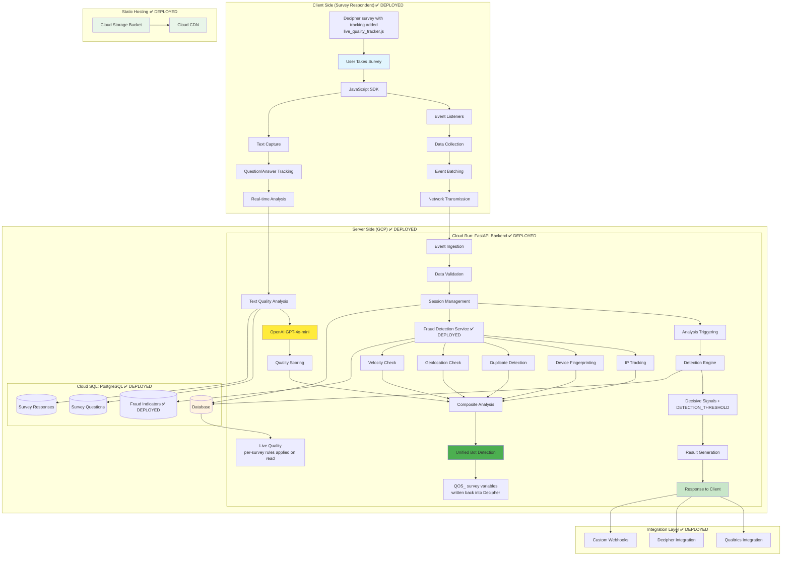

## 2. Data Collection Flow

**Status**: ✅ **DEPLOYED** - All data collection mechanisms operational in production

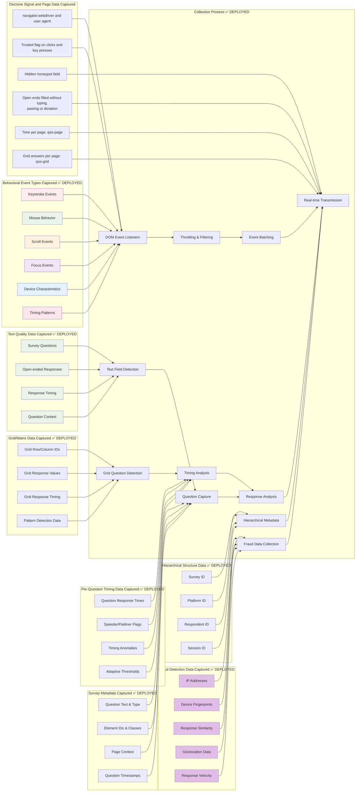

## 3. Detection Methods & Weights

**Status**: ✅ **DEPLOYED** - All detection methods operational with 100% test accuracy

```mermaid
graph TB
    subgraph "Behavioral Detection Methods ✅ DEPLOYED"
        A[Keystroke Analysis<br/>30% Weight]
        B[Mouse Analysis<br/>25% Weight]
        C[Timing Analysis<br/>20% Weight]
        D[Device Analysis<br/>15% Weight]
        E[Network Analysis<br/>0% Weight, not implemented]
    end
    
    subgraph "Decisive Signals"
        DS1[automation]
        DS2[scripted_input]
        DS3[no_input]
        DS4[honeypot]
        DS5[untyped_answers]
        DS6[One signal: score at least 0.85<br/>Two or more: at least 0.95]
    end
    
    subgraph "Text Quality Analysis ✅ DEPLOYED"
        F1[Gibberish Detection<br/>GPT-4o-mini]
        F2[Copy-Paste Detection<br/>GPT-4o-mini]
        F3[Relevance Analysis<br/>GPT-4o-mini]
        F4[Generic Answer Detection<br/>GPT-4o-mini]
        F5[Overall Quality Score<br/>GPT-4o-mini]
    end
    
    subgraph "Fraud Detection Methods ✅ DEPLOYED"
        G1[IP Address Tracking<br/>25% Weight]
        G2[Device Fingerprinting<br/>25% Weight]
        G3[Duplicate Response Detection<br/>20% Weight]
        G4[Geolocation Consistency<br/>15% Weight]
        G5[Velocity Checking<br/>15% Weight]
    end
    
    subgraph "Grid/Matrix Analysis ✅ DEPLOYED"
        H1[Straight-lining Detection<br/>80%+ identical values]
        H2[Pattern Detection<br/>Diagonal/Zigzag/Reverse]
        H3[Variance Scoring<br/>0-1 scale]
        H4[Satisficing Scoring<br/>0-1 scale]
    end
    
    subgraph "Timing Analysis ✅ DEPLOYED"
        I1[Speeder Detection<br/>< 2000ms threshold]
        I2[Flatliner Detection<br/>> 300000ms threshold]
        I3[Anomaly Detection<br/>Z-score > 2.5]
        I4[Adaptive Thresholds<br/>Question-specific norms]
    end
    
    subgraph "Composite Analysis Process ✅ DEPLOYED"
        H[Individual Method Scoring<br/>0.0 - 1.0]
        I[Behavioral Weight: 40%]
        J[Text Quality Weight: 30%]
        K[Fraud Detection Weight: 30%]
        L[Weighted Combination]
        M[Confidence Calculation]
        N[Classification Decision<br/>score >= DETECTION_THRESHOLD, default 0.7]
    end
    
    A --> H
    B --> H
    C --> H
    D --> H
    E --> H
    
    DS1 --> DS6
    DS2 --> DS6
    DS3 --> DS6
    DS4 --> DS6
    DS5 --> DS6
    DS6 --> H
    
    F1 --> H
    F2 --> H
    F3 --> H
    F4 --> H
    F5 --> H
    
    G1 --> H
    G2 --> H
    G3 --> H
    G4 --> H
    G5 --> H
    
    H1 --> H
    H2 --> H
    H3 --> H
    H4 --> H
    
    I1 --> H
    I2 --> H
    I3 --> H
    I4 --> H
    
    H --> I
    H --> J
    H --> K
    I --> L
    J --> L
    K --> L
    L --> M
    M --> N
    
    N --> O{Is Bot?}
    O -->|Yes| P[Bot Classification]
    O -->|No| Q[Human Classification]
    
    style A fill:#ffcdd2
    style B fill:#c8e6c9
    style C fill:#ffe0b2
    style D fill:#bbdefb
    style E fill:#f8bbd9
    style F1 fill:#ffeb3b
    style F2 fill:#ffeb3b
    style F3 fill:#ffeb3b
    style F4 fill:#ffeb3b
    style F5 fill:#ffeb3b
    style G1 fill:#e1bee7
    style G2 fill:#e1bee7
    style G3 fill:#e1bee7
    style G4 fill:#e1bee7
    style G5 fill:#e1bee7
    style H1 fill:#b39ddb
    style H2 fill:#b39ddb
    style H3 fill:#b39ddb
    style H4 fill:#b39ddb
    style I1 fill:#ce93d8
    style I2 fill:#ce93d8
    style I3 fill:#ce93d8
    style I4 fill:#ce93d8
    style P fill:#ffcdd2
    style Q fill:#c8e6c9
```

**How the weights are used**:
- The behaviour score is the weighted average of keystroke (0.3), mouse (0.25), timing (0.2) and device (0.15). Network analysis returns 0.0 and has no weight.
- Decisive signals are patterns people do not produce. One raises the behaviour score to at least 0.85, two or more to at least 0.95. The score before that lift is stored as `base_score`, and the signal codes as `decisive_codes`.
- A session is stored as a bot when its behaviour score is at or above `DETECTION_THRESHOLD` (Settings page, default 0.7).
- The composite score is 40% behaviour, 30% text-quality risk (1 − quality/100) and 30% fraud. The composite verdict uses the same `DETECTION_THRESHOLD`.
- Grid and per-question timing results are reported next to the composite score (and in the `QOS_` variables), but they do not change the composite number.

## 4. Fraud Detection Analysis Flow

**Status**: ✅ **DEPLOYED** - Complete fraud detection service operational with all 5 detection methods

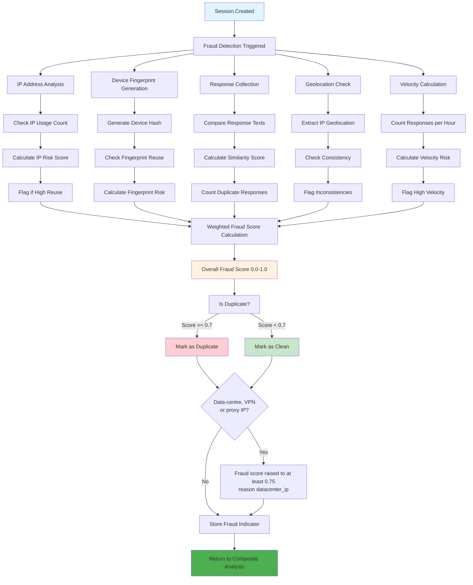

## 5. Text Quality Analysis Flow

**Status**: ✅ **DEPLOYED** - OpenAI GPT-4o-mini integration fully operational with 100% test accuracy

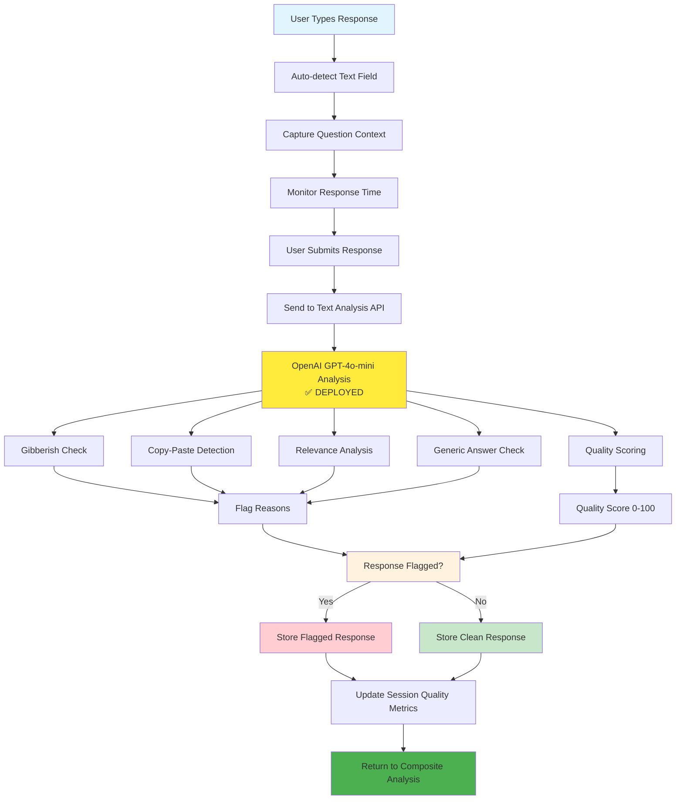

## 6. Decision Making Process

The tracker calls `composite-analyze` when the respondent submits the last page. That call stores a fresh behavioural verdict, runs the grid, timing and fraud checks, then builds the composite result. Analysis does not wait for a minimum number of events: with fewer than 5 key presses the keystroke score is 0.3, and a touch device gets a mouse score of 0.3.

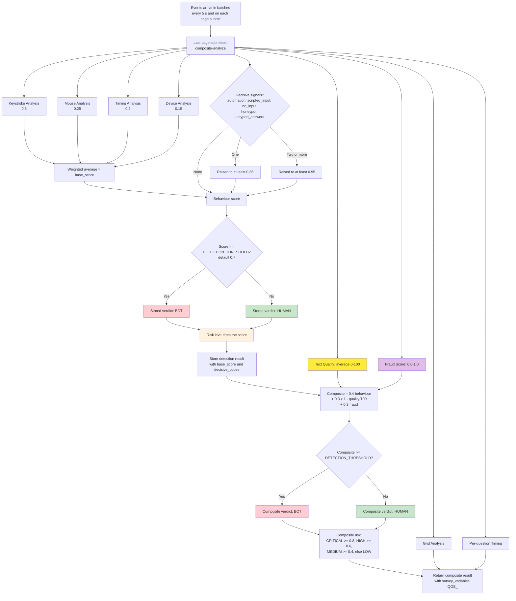

The stored verdict and the composite verdict both use `DETECTION_THRESHOLD`. Changing it on the Settings page affects analyses run after the change; results already stored keep their verdict. Live Quality can judge stored results again under a survey's own rules (see section 14).

## 7. Confidence Scoring & Risk Levels

The behaviour score is a bot probability: 0.0 looks human, 1.0 looks like a bot. The verdict line is `DETECTION_THRESHOLD` (default 0.7), so the ranges below assume the default.

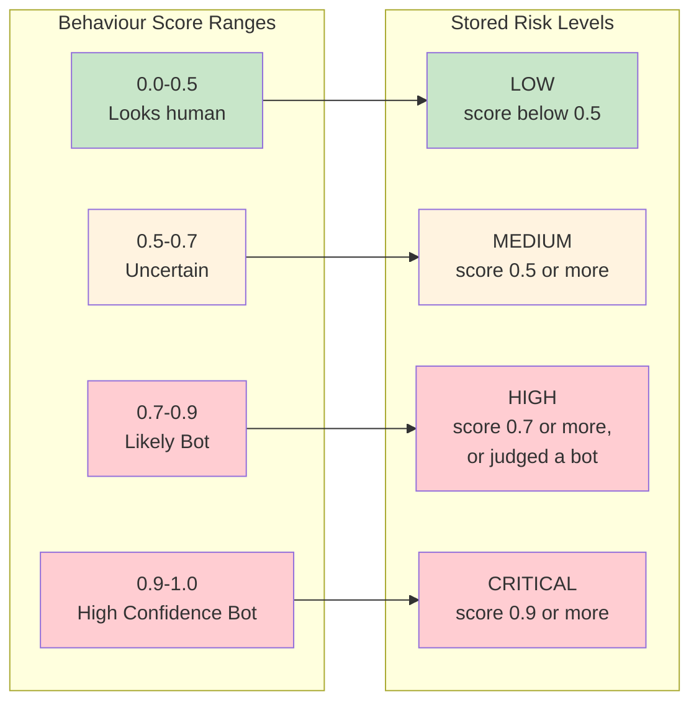

- A session judged a bot is at least HIGH, even if the threshold was set below 0.7.
- The composite result has its own risk level: CRITICAL from 0.8, HIGH from 0.6, MEDIUM from 0.4, otherwise LOW.
- Live Quality shows the behaviour risk from the stored score (HIGH from 0.7, MEDIUM from 0.5, otherwise LOW), raised to HIGH for any respondent its rules judge a bot.

## 8. Integration Flow

For Decipher, tracking is added to the survey XML on the Add tracking page (`POST /api/v1/tracking/decipher`). The file gets the tracker script as a `respview.client.js` style with `mode="after"`, Decipher's `${uuid}` as the respondent id, a hidden results page with the 21 `QOS_` variables, an optional privacy notice (`QOS_privacy`, on by default) and an optional early end on a clear bot signal (`QOS_EARLY` and `QOS_bot_term`, off by default). Removing the tracking gives back the original file byte for byte.

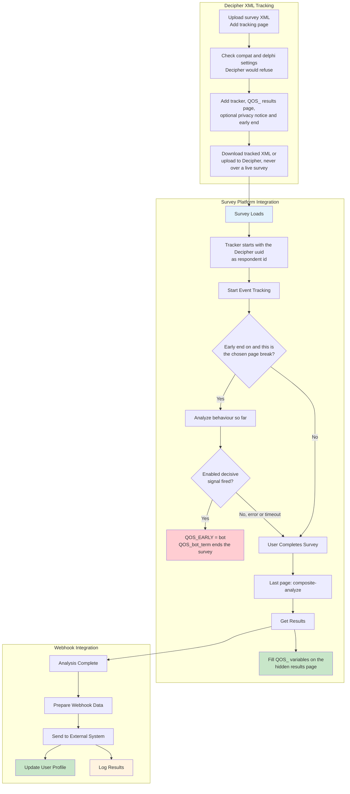

**Early end on a clear bot signal**: when turned on, a hidden `QOS_EARLY` question goes on a page break every respondent reaches (page 2 by default). On that submit the tracker holds the page for at most 2.5 seconds, scores the behaviour so far, and writes `bot` only if one of the decisive signals chosen for the survey fired. The `QOS_bot_term` termination reads that value. A behaviour score alone, an error or a timeout leaves the respondent in the survey. If the survey has no such page break, the early check is not added and the final check still runs.

**Final check**: on the last page the tracker holds the submit for at most 3 seconds while `composite-analyze` runs, then fills `QOS_FLAG` (bot, human or unknown), `QOS_SCORE`, `QOS_RISK` and the numeric `QOS_` variables from `survey_variables`. These values reach Decipher's own data exports. They are fixed when written; per-survey rules on Live Quality do not change them.

## 9. Data Processing Pipeline

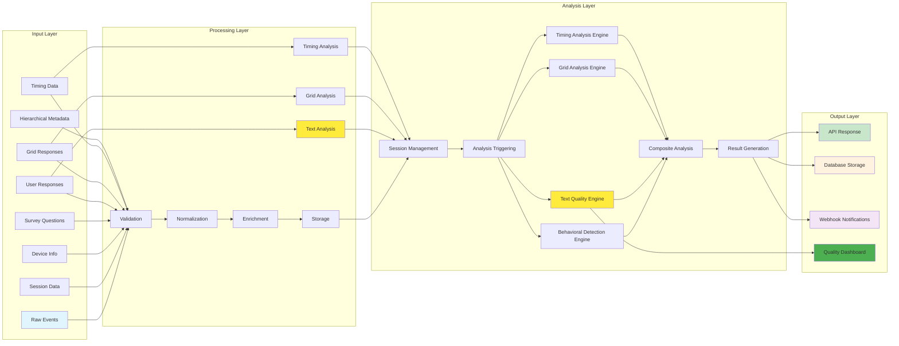

## 10. Bot vs Human Indicators

```mermaid
graph TB
    subgraph "Behavioral Bot Indicators"
        A1[Too Regular Typing<br/>std dev < 10ms within bursts]
        A2[Too Fast Typing<br/>average < 50ms, or rounded intervals]
        A3[Same-length Mouse Steps]
        A4[Perfectly Straight Mouse Path]
        A5[Clockwork Event Timing<br/>gaps vary < 0.1s, session < 10s]
        A6[Screen Size Changes or Empty Screen]
    end
    
    subgraph "Decisive Bot Signals"
        D1[automation<br/>webdriver or headless user agent]
        D2[scripted_input<br/>half or more of clicks and keys untrusted]
        D3[no_input<br/>pages answered with no mouse or keyboard]
        D4[honeypot<br/>hidden field filled in]
        D5[untyped_answers<br/>open ends with no typing, pasting or dictation]
    end
    
    subgraph "Behavioral Human Indicators"
        B1[Natural Variation<br/>std dev > 10ms]
        B2[Realistic Typing Speed<br/>pauses over 2s are ignored]
        B3[Varied Mouse Step Lengths]
        B4[Curved Movements]
        B5[Irregular Patterns]
        B6[One Stable Screen Size]
    end
    
    subgraph "Text Quality Bot Indicators"
        A7[Gibberish Text<br/>Random characters]
        A8[Copy-Paste Content<br/>Generic responses]
        A9[Irrelevant Answers<br/>Off-topic responses]
        A10[Generic Responses<br/>Low-effort answers]
        A11[Very Low Quality<br/>Score < 30]
    end
    
    subgraph "Grid/Matrix Bot Indicators ✅ DEPLOYED"
        A17[Straight-lining<br/>80%+ identical values]
        A18[Diagonal Patterns<br/>Mechanical patterns]
        A19[Low Variance<br/>No response diversity]
        A20[High Satisficing<br/>Low-effort responses]
    end
    
    subgraph "Timing Bot Indicators ✅ DEPLOYED"
        A21[Speeders<br/>Response < 2000ms]
        A22[Flatliners<br/>Response > 300000ms]
        A23[Timing Anomalies<br/>Z-score > 2.5]
        A24[Inconsistent Timing<br/>No natural variation]
    end
    
    subgraph "Fraud Detection Bot Indicators ✅ DEPLOYED"
        A12[IP Address Reuse<br/>Multiple sessions from same IP]
        A13[Device Fingerprint Reuse<br/>Same device across sessions]
        A14[Duplicate Responses<br/>High text similarity]
        A15[Geolocation Inconsistency<br/>IP location mismatch]
        A16[High Velocity<br/>Rapid response submission]
    end
    
    subgraph "Text Quality Human Indicators"
        B7[Coherent Text<br/>Meaningful responses]
        B8[Original Content<br/>Personal insights]
        B9[Relevant Answers<br/>On-topic responses]
        B10[Specific Details<br/>Thoughtful answers]
        B11[High Quality<br/>Score > 70]
    end
    
    subgraph "Analysis Methods"
        C1[Keystroke Analysis]
        C2[Mouse Analysis]
        C3[Timing Analysis]
        C4[Device Analysis]
        C5[Network Analysis<br/>not implemented]
        C6[Text Quality Analysis<br/>GPT-4o-mini]
        C14[Decisive Signal Check]
        C7[IP Address Tracking ✅ DEPLOYED]
        C8[Device Fingerprinting ✅ DEPLOYED]
        C9[Duplicate Detection ✅ DEPLOYED]
        C10[Geolocation Checking ✅ DEPLOYED]
        C11[Velocity Checking ✅ DEPLOYED]
        C12[Grid Analysis ✅ DEPLOYED]
        C13[Per-Question Timing ✅ DEPLOYED]
    end
    
    A1 --> C1
    A2 --> C1
    A3 --> C2
    A4 --> C2
    A5 --> C3
    A6 --> C4
    
    D1 --> C14
    D2 --> C14
    D3 --> C14
    D4 --> C14
    D5 --> C14
    
    B1 --> C1
    B2 --> C1
    B3 --> C2
    B4 --> C2
    B5 --> C3
    B6 --> C4
    
    A7 --> C6
    A8 --> C6
    A9 --> C6
    A10 --> C6
    A11 --> C6
    
    B7 --> C6
    B8 --> C6
    B9 --> C6
    B10 --> C6
    B11 --> C6
    
    A12 --> C7
    A13 --> C8
    A14 --> C9
    A15 --> C10
    A16 --> C11
    
    A17 --> C12
    A18 --> C12
    A19 --> C12
    A20 --> C12
    
    A21 --> C13
    A22 --> C13
    A23 --> C13
    A24 --> C13
    
    style A1 fill:#ffcdd2
    style A2 fill:#ffcdd2
    style A3 fill:#ffcdd2
    style A4 fill:#ffcdd2
    style A5 fill:#ffcdd2
    style A6 fill:#ffcdd2
    style A7 fill:#ffcdd2
    style A8 fill:#ffcdd2
    style A9 fill:#ffcdd2
    style A10 fill:#ffcdd2
    style A11 fill:#ffcdd2
    style B1 fill:#c8e6c9
    style B2 fill:#c8e6c9
    style B3 fill:#c8e6c9
    style B4 fill:#c8e6c9
    style B5 fill:#c8e6c9
    style B6 fill:#c8e6c9
    style B7 fill:#c8e6c9
    style B8 fill:#c8e6c9
    style B9 fill:#c8e6c9
    style B10 fill:#c8e6c9
    style B11 fill:#c8e6c9
    style A12 fill:#ffcdd2
    style A13 fill:#ffcdd2
    style A14 fill:#ffcdd2
    style A15 fill:#ffcdd2
    style A16 fill:#ffcdd2
    style A17 fill:#ffcdd2
    style A18 fill:#ffcdd2
    style A19 fill:#ffcdd2
    style A20 fill:#ffcdd2
    style A21 fill:#ffcdd2
    style A22 fill:#ffcdd2
    style A23 fill:#ffcdd2
    style A24 fill:#ffcdd2
    style C6 fill:#ffeb3b
    style C7 fill:#e1bee7
    style C8 fill:#e1bee7
    style C9 fill:#e1bee7
    style C10 fill:#e1bee7
    style C11 fill:#e1bee7
    style C12 fill:#b39ddb
    style C13 fill:#ce93d8
```

## 11. Grid/Matrix Analysis Flow

**Status**: ✅ **DEPLOYED** - Complete grid analysis system operational with pattern detection and satisficing scoring

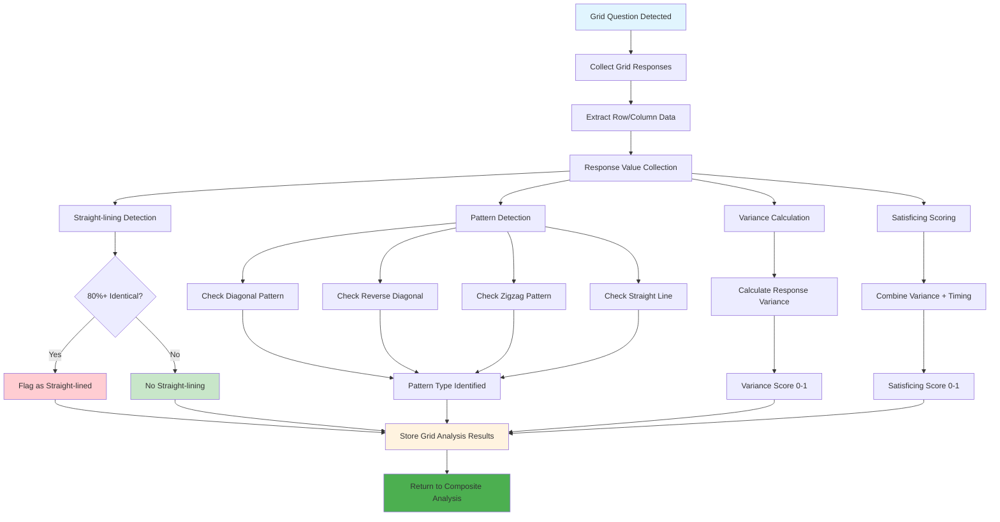

The number of straight-lined grids from this analysis is written to `QOS_STRAIGHTLINE`. Live Quality also reads the grid answers the tracker stores for each page (`qos-grid:`, sent for grids with 3 or more rows) and flags Straight-lining when every row of a grid has the same answer and the grid has at least the survey's `straightline_min_rows` rows (default 3), or when this analysis already flagged it.

## 12. Per-Question Timing Analysis Flow

**Status**: ✅ **DEPLOYED** - Complete timing analysis system operational with speeder/flatliner detection and anomaly scoring

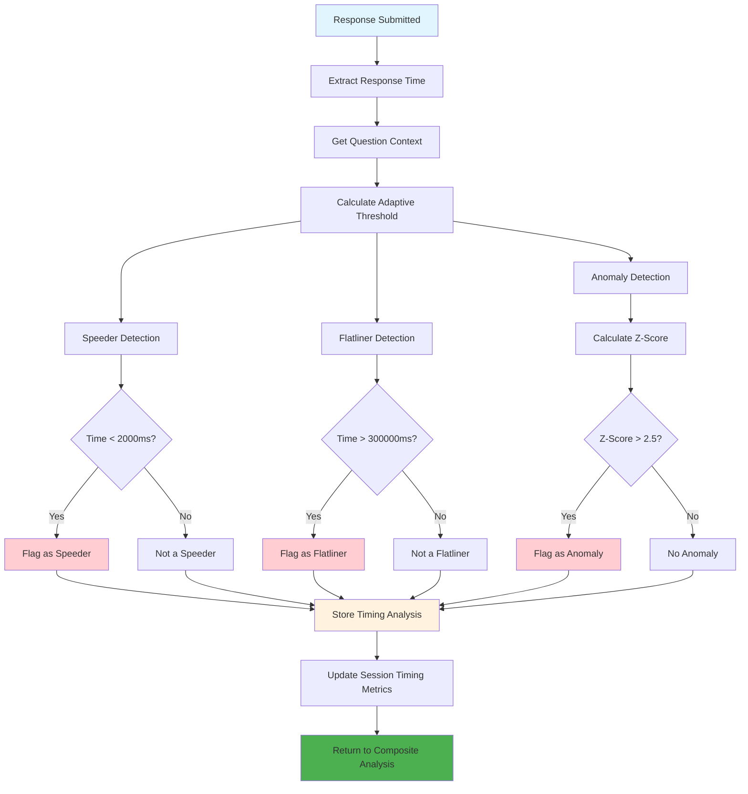

The number of speeder answers from this analysis is written to `QOS_SPEEDER`, and flatliners show as the Flatliner flag on Live Quality. The Live Quality Speeder flag does not use per-answer times, because a quick short answer would count. It uses page times instead (see section 14).

## 13. Text Analysis Dashboard Flow

**Status**: ✅ **DEPLOYED** - Complete text analysis dashboard with filtering, pagination, and CSV export

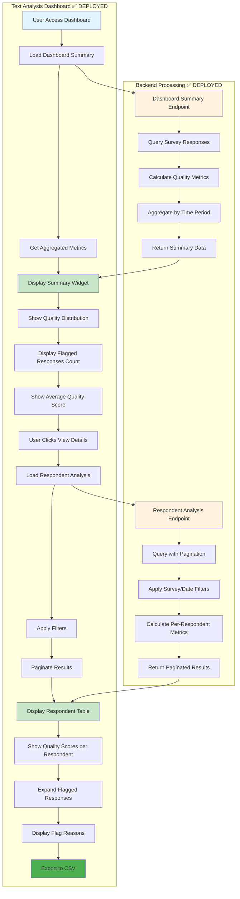

## 14. Live Quality Judging Flow

Live Quality (`/quality` page, `GET /api/v1/quality/results?survey_id=`) judges one survey's stored results under that survey's quality rules. Rules are applied on every read: the dashboard, the CSV export and the `LQ_` variables. Editing a rule never changes stored results or the `QOS_` values already written into Decipher. A survey with no saved rules uses the defaults.

| Rule | Default | What it does |
|------|---------|--------------|
| `bot_threshold` | 0.7 | Bot when the stored `base_score` (the behaviour score before decisive signals lifted it) is at or above this |
| `bot_signals` | all five | Decisive signals that make a respondent a bot on their own |
| `speeder_page_seconds` | 3.5 | Speeder when pages average under this many seconds |
| `speeder_median_share` | 0.5 | Speeder when total time is under this share of the median (needs 5 checked respondents with page times; 0 = off) |
| `straightline_min_rows` | 3 | Smallest grid that counts for straight-lining |
| `text_reasons` | all five | Which text-check reasons count as low-quality open ends: gibberish, generic, irrelevant, copy_paste, low_quality |
| `flag_pasted` | on | Flag answers that were pasted or appeared without typing |
| `fraud_threshold` | 0.7 | High fraud risk when the fraud score is at or above this |
| `flag_duplicates` | on | Flag respondents the fraud check marked as duplicates |
| `flag_datacenter` | on | Flag data-centre, VPN or proxy IP addresses |

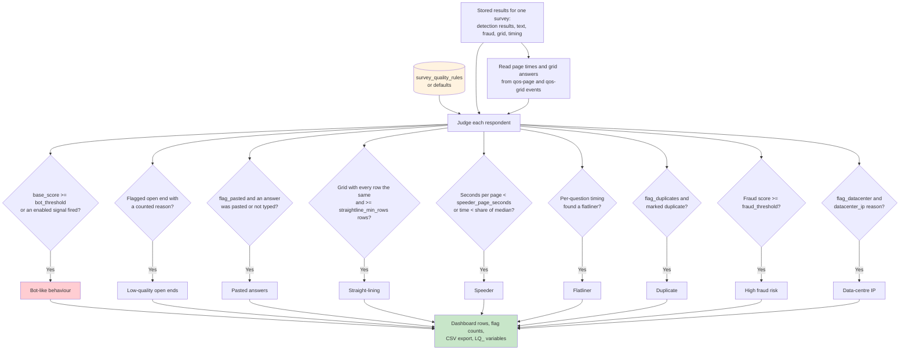

- Results stored before `base_score` existed are judged on their stored score.
- If a fraud score is missing, High fraud risk falls back to a stored fraud risk level of HIGH or CRITICAL.
- Respondents are `checked` once analysed, `in_progress` if active in the last 20 minutes, otherwise `dropped`. Only checked respondents get a bot or human verdict.

**Bot rate**: everywhere in the service (Overview, Sessions, survey and platform pages, `/dashboard/overview`, `/surveys`), the bot rate is distinct sessions judged bots divided by distinct sessions checked (analysed). A session analysed twice counts once. These pages use the stored verdicts; the Live Quality bot count uses the survey's rules.

## 15. Survey Data Variables

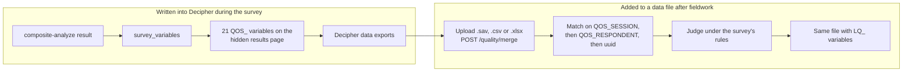

**`QOS_` variables** (fixed when the respondent finishes): QOS_RESPONDENT, QOS_SESSION, QOS_FLAG, QOS_SCORE, QOS_RISK, QOS_STATUS (1 human, 2 suspect, 3 bot), QOS_BEHAV, QOS_OES, QOS_FRAUD, QOS_DUP, QOS_DUP_SCORE, QOS_IP_RISK, QOS_DEVICE_RISK, QOS_GEO_RISK, QOS_VELOCITY, QOS_DATACENTER, QOS_SPEEDER, QOS_STRAIGHTLINE, QOS_FLAGCOUNT, QOS_REASON, QOS_REASONS. Scores are whole numbers from 0 to 100. QOS_OES is a quality score (higher is better); the other scores are risk scores (higher is worse). A value is left blank when its check had nothing to work on. QOS_STATUS is 3 when the stored or composite verdict is bot, 2 when any reason code applies or the composite risk is MEDIUM or higher, otherwise 1.

**Reason codes** (QOS_REASONS lists all that apply; QOS_REASON is the lowest, most severe one; 0 means none):

| Code | Reason |
|------|--------|
| 1 | automation: automated or headless browser |
| 2 | scripted_input: clicks and key presses generated by script |
| 3 | no_input: pages answered with no mouse or keyboard use |
| 4 | honeypot: hidden honeypot field filled in |
| 5 | untyped_answers: open ends that appeared without typing |
| 6 | behaviour: bot-like behaviour score (only when judged a bot with no decisive signal) |
| 10 | datacenter_ip: data centre, VPN or proxy IP address |
| 11 | device_reuse: same device seen on other sessions |
| 12 | ip_reuse: same IP address used repeatedly |
| 13 | duplicate_responses: answers copied from another respondent |
| 14 | high_velocity: many surveys started in a short time |
| 15 | geolocation_inconsistency: location does not match |
| 20 | low_quality_open_ends: low-quality open-ended answers |
| 21 | straight_lining: straight-lined grid questions |
| 22 | speeder: questions answered too fast |

**`LQ_` variables** (judged under the survey's rules at upload time): LQ_MATCHED, LQ_STATUS, LQ_VERDICT, LQ_BOT_SCORE, LQ_BOT_RISK, LQ_BOT_SIGNALS, LQ_SECONDS, LQ_PAGES, LQ_SEC_PER_PAGE, LQ_TEXT_QUALITY, LQ_FRAUD_SCORE, LQ_FRAUD_RISK, one 0/1 variable per flag (LQ_F_BOT, LQ_F_TEXT, LQ_F_PASTED, LQ_F_STRAIGHT, LQ_F_SPEEDER, LQ_F_FLATLINE, LQ_F_DUPLICATE, LQ_F_FRAUD, LQ_F_DATACENTRE), LQ_NFLAGS and LQ_FLAGS. Uploading again replaces existing `LQ_` columns.